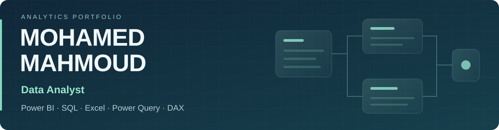
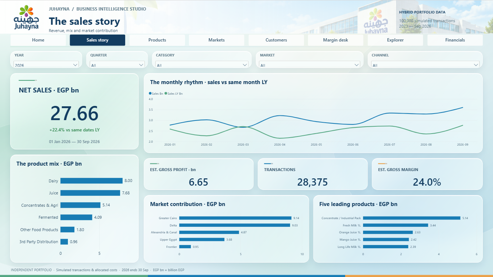
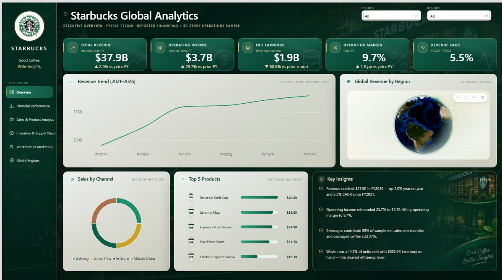
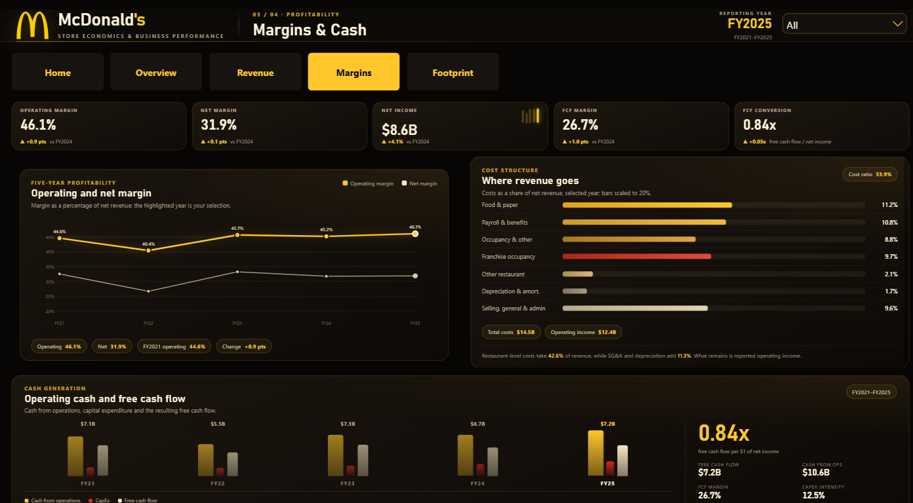
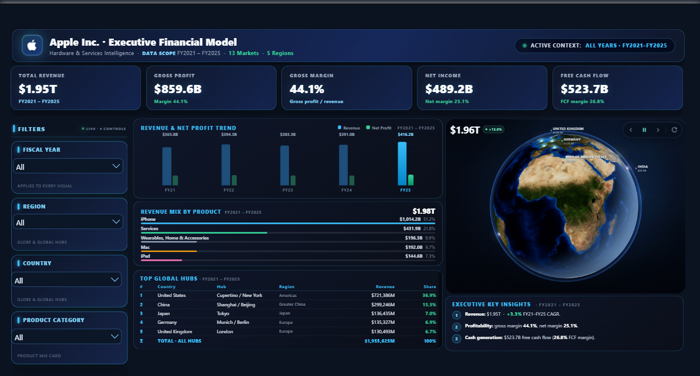
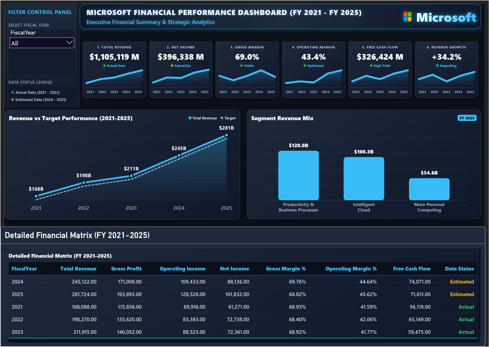
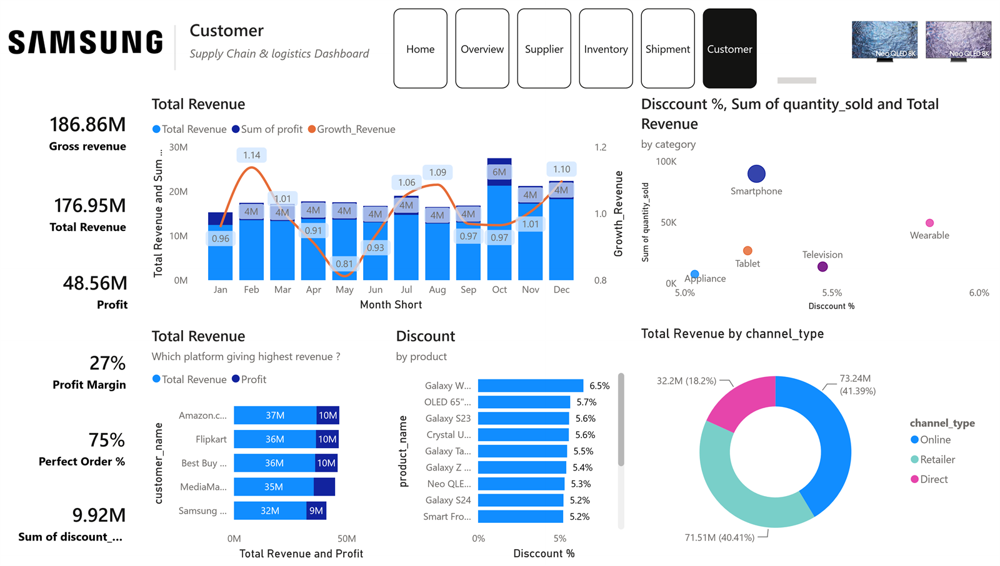

  

  <strong>Data Analyst · Cairo, Egypt</strong> 
  I build interactive reports that connect business questions, data models, and clear visual analysis.

  <a href="#selected-projects">Selected projects</a> &nbsp;·&nbsp;
  <a href="#how-i-work">How I work</a> &nbsp;·&nbsp;
  <a href="https://www.linkedin.com/in/mohammed-mahmoud-a2a1973b4">LinkedIn</a> &nbsp;·&nbsp;
  <a href="https://github.com/momahmoud02?tab=repositories">All repositories</a>

## Selected projects

A focused collection of my recent Power BI work, covering sales, financial performance, and operations. Open a project to explore its files, methodology, and data assumptions.

<table>
  <tr>
    <td width="50%" valign="top">
      <h3>Juhayna Studio</h3>
      
      
Sales, product mix, markets, customers, and profitability in a nine-page report with 80 DAX measures and a dedicated Home page.

      
HYBRID DATA · Simulated transactions and allocated costs; financial figures retained from the source workbook.

      
<code>Power BI</code> <code>DAX</code> <code>Power Query</code>

      
<a href="https://github.com/momahmoud02/juhayna-studio"><strong>Explore Juhayna →</strong></a>

    </td>
    <td width="50%" valign="top">
      <h3>Starbucks Global Analytics</h3>
      
      
A seven-page report connecting financial performance with store sales, inventory, workforce, and regional analysis.

      
HYBRID DATA · Financial figures presented as reported in the source; a synthetic 60-store operations sample.

      
<code>Power BI</code> <code>DAX</code> <code>Custom visual</code>

      
<a href="https://github.com/momahmoud02/starbucks-global-analytics"><strong>Explore Starbucks →</strong></a>

    </td>
  </tr>
  <tr>
    <td width="50%" valign="top">
      <h3>McDonald's Store Economics</h3>
      
      
FY2021–FY2025 analysis of the franchise model, restaurant footprint, profitability, investment, and cash generation.

      
FINANCIAL ANALYSIS · Annual-report-based figures; supplemental market allocations and metric caveats documented in the repository.

      
<code>Power BI</code> <code>DAX</code> <code>Financial statements</code>

      
<a href="https://github.com/momahmoud02/McDonalds-Store-Economics"><strong>Explore McDonald's →</strong></a>

    </td>
    <td width="50%" valign="top">
      <h3>Apple Revenue Atlas</h3>
      
      
An FY2021–FY2025 executive dashboard combining product mix, profitability, geographic analysis, and synchronized filters.

      
FINANCIAL ANALYSIS · Annual-report-based figures with allocated country-level views, not reported country revenue.

      
<code>Power BI</code> <code>DAX</code> <code>TypeScript</code>

      
<a href="https://github.com/momahmoud02/apple-revenue-atlas"><strong>Explore Apple →</strong></a>

    </td>
  </tr>
  <tr>
    <td width="50%" valign="top">
      <h3>Microsoft Financial Analysis</h3>
      
      
FY2021–FY2025 financial-statement and segment analysis, linking an Excel source workbook to an executive Power BI dashboard.

      
MIXED ACTUAL / ESTIMATED · The dashboard distinguishes actual figures, estimated periods, and analytical targets.

      
<code>Power BI</code> <code>Excel</code> <code>DAX</code>

      
<a href="https://github.com/momahmoud02/microsoft-financial-analysis"><strong>Explore Microsoft →</strong></a>

    </td>
    <td width="50%" valign="top">
      <h3>Samsung Supply Chain Analytics</h3>
      
      
A supply-chain data model with a developed customer analytics page covering revenue, margin, discounts, channels, and order quality.

      
SAMPLE DATA · Illustrative consumer-electronics operations; the repository documents the scope of each report page.

      
<code>Power BI</code> <code>Star schema</code> <code>Customer analytics</code>

      
<a href="https://github.com/momahmoud02/samsung-supply-chain-analytics"><strong>Explore Samsung →</strong></a>

    </td>
  </tr>
</table>

Independent portfolio projects, not commissioned by or affiliated with the featured brands. Data sources, estimates, allocations, and sample boundaries matter as much as the visuals.

## How I work

| Stage | What I focus on |
| :--- | :--- |
| Frame the question | Define the business question, reporting scope, and useful KPIs. |
| Prepare and model | Clean data, build relationships, and keep the model understandable. |
| Calculate and validate | Write DAX, reconcile totals, and check filter behavior and comparison periods. |
| Design and explain | Build readable dashboards and make assumptions and limitations visible. |

**Tools:** Power BI · Power Query · DAX · Excel · SQL

**Background:** Commerce and accounting, with a focus on business intelligence and practical data analysis.

## Let's connect

For dashboard projects, analytics collaboration, or Data Analyst opportunities, connect with me on [LinkedIn](https://www.linkedin.com/in/mohammed-mahmoud-a2a1973b4).

[Browse the full project collection →](https://github.com/momahmoud02?tab=repositories)
